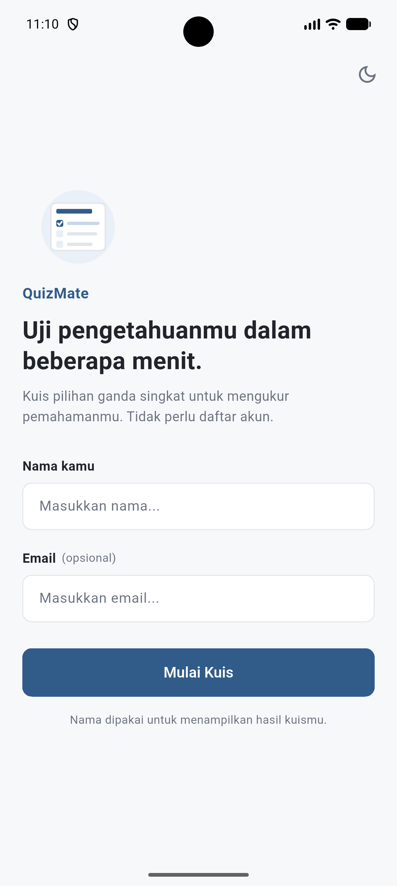
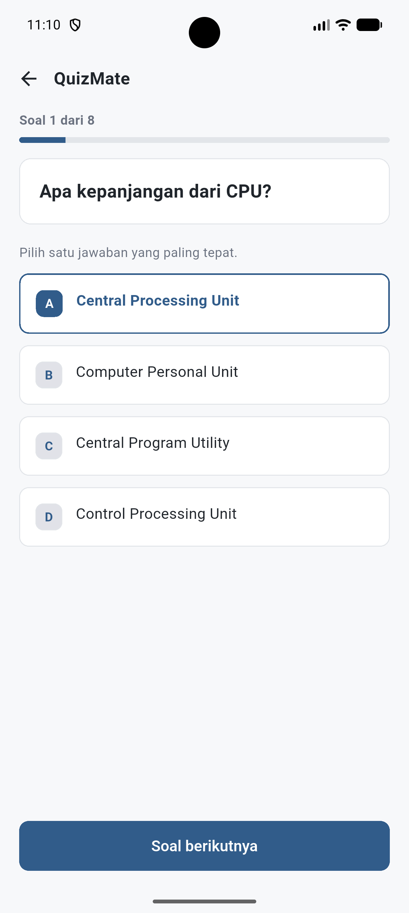
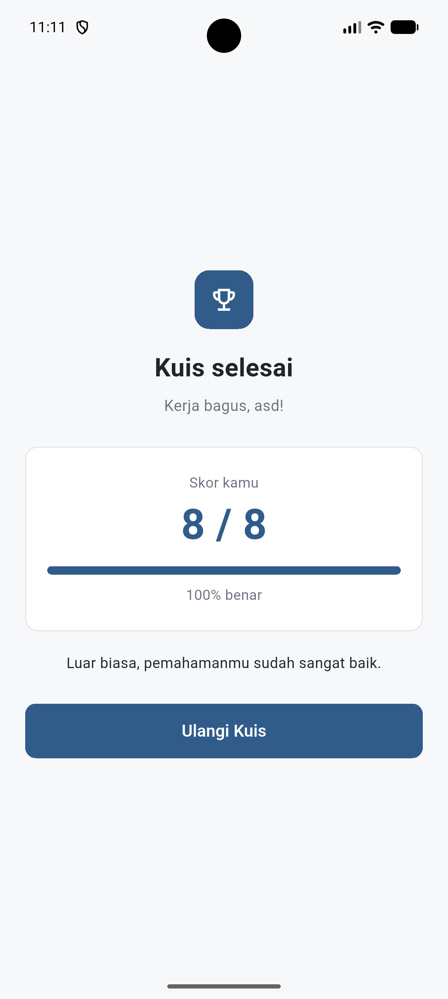
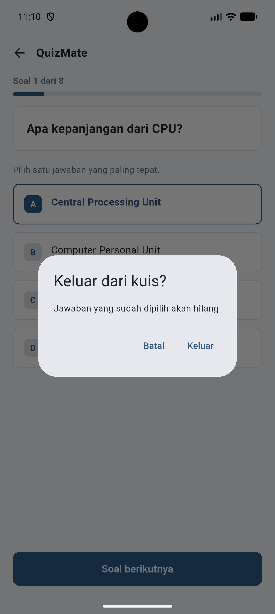
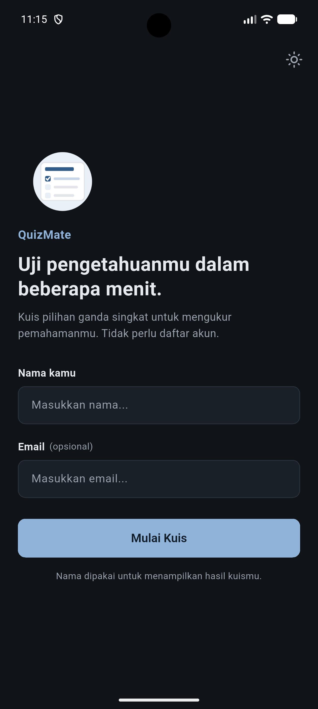

# QuizMate

QuizMate adalah aplikasi kuis pilihan ganda sederhana berbasis Flutter. Pengguna
memasukkan nama, mengerjakan soal pilihan ganda, lalu melihat jumlah
jawaban benar beserta persentasenya di halaman hasil. Seluruh soal masih
disimpan secara lokal di dalam aplikasi dan tidak memerlukan akun.

## Informasi Project

| Item | Keterangan |
| --- | --- |
| Nama aplikasi | QuizMate |
| Tujuan | Media latihan kuis pilihan ganda singkat untuk mengukur pemahaman dasar |
| Framework | Flutter (Material 3) |
| Bahasa pemrograman | Dart |
| Platform | Android, iOS, web, Linux, macOS, dan Windows (folder platform tersedia dari template Flutter) |
| Repositori | [github.com/Farhan00755/QuizMate](https://github.com/Farhan00755/QuizMate) |

## Fitur Aplikasi

### Yang telah diimplementasikan

- Halaman awal dengan ilustrasi, judul, dan deskripsi singkat aplikasi.
- Input nama pengguna dengan validasi wajib diisi (maksimal 40 karakter).
- Input email opsional dengan validasi format (maksimal 80 karakter).
- Delapan soal pilihan ganda bertema dasar komputer dan teknologi (dummy).
- Indikator progres berupa teks "Soal x dari y" dan progress bar.
- Pemilihan jawaban; pengguna dapat mengganti pilihan sebelum lanjut ke soal berikutnya.
- Tombol "Soal berikutnya" nonaktif sampai soal saat ini dijawab.
- Perhitungan jumlah jawaban benar dan persentase skor.
- Halaman hasil dengan skor, persentase, dan umpan balik sesuai rentang nilai.
- Tombol "Ulangi Kuis" untuk kembali ke halaman awal.
- Dialog konfirmasi saat keluar dari kuis yang sudah dijawab.
- Navigasi antarhalaman (Home → Quiz → Result) dan tombol kembali.
- Mode terang dan gelap yang dapat diganti dari halaman awal.

### Catatan implementasi

- Email hanya divalidasi formatnya dan belum disimpan atau dikirim ke layanan
  mana pun.
- Soal, kunci jawaban, dan skor masih bersifat lokal (in-memory) dan belum
  tersimpan setelah aplikasi ditutup.
- Pilihan tema tidak disimpan sebagai preferensi permanen.

## Teknologi yang Digunakan

- **Flutter** — framework UI lintas platform.
- **Dart** — bahasa pemrograman utama.
- **Material 3** — sistem desain bawaan Flutter yang dipakai melalui `ThemeData`.
- **`ChangeNotifier` + `ListenableBuilder`** — pengelolaan state kuis tanpa
  package state management tambahan.
- **`cupertino_icons`** — dependency ikon bawaan template Flutter.
- **`flutter_lints`** — aturan lint untuk analisis kode (dev dependency).

Environment :

- Flutter 3.47.1 (stable)
- Dart 3.13.1
- SDK constraint: `^3.13.1`

## Struktur Folder

```text
quiz_mate/
├── lib/
│   ├── main.dart                  # Entry point dan pengaturan tema terang/gelap
│   ├── constants/
│   │   └── app_colors.dart        # Palet warna aplikasi
│   ├── data/
│   │   └── questions.dart         # Data soal kuis
│   ├── models/
│   │   └── question.dart          # Model Question
│   ├── screens/
│   │   ├── home_screen.dart       # Halaman awal dan form pengguna
│   │   ├── quiz_screen.dart       # Halaman pengerjaan kuis
│   │   └── result_screen.dart     # Halaman hasil dan skor
│   ├── state/
│   │   └── quiz_controller.dart   # Logika state kuis
│   ├── theme/
│   │   └── app_theme.dart         # Konfigurasi tema terang dan gelap
│   └── widgets/
│       └── primary_button.dart    # Komponen tombol utama
├── assets/
│   ├── fonts/
│   │   ├── Roboto-Regular.ttf
│   │   ├── Roboto-Medium.ttf
│   │   └── Roboto-Bold.ttf
│   └── images/
│       └── quiz_illustration.png
├── test/
│   ├── quiz_controller_test.dart
│   └── widget_test.dart
├── android/  ios/  web/  linux/  macos/  windows/
├── pubspec.yaml
└── README.md
```

## Screenshot Aplikasi

### Home Screen
<p align="center">
  
</p>

### Quiz Screen
<p align="center">
  
</p>

### Result Screen
<p align="center">
  
</p>

### Dialog Keluar Kuis
<p align="center">
  
</p>

### Home Screen Mode Gelap (opsional)
<p align="center">
  
</p>

## Cara Menjalankan Aplikasi

### Prasyarat

- Flutter SDK yang kompatibel dengan Dart `^3.13.1` (project ini dikembangkan
  dengan Flutter 3.47.1 stable).
- Emulator Android/iOS atau perangkat fisik, atau target desktop/web yang
  tersedia di lingkungan pengembangan.

### Langkah menjalankan

1. Clone repositori:

   ```bash
   git clone https://github.com/Farhan00755/QuizMate.git
   ```

2. Masuk ke direktori project:

   ```bash
   cd QuizMate
   ```

3. Unduh dependency:

   ```bash
   flutter pub get
   ```

4. Periksa lingkungan dan perangkat yang tersedia:

   ```bash
   flutter --version
   flutter devices
   ```

5. Hubungkan emulator atau perangkat, lalu jalankan aplikasi:

   ```bash
   flutter run
   ```

### Pemeriksaan kode dan pengujian

```bash
flutter analyze
flutter test
```

## Mockup atau Prototype

[[Link Mockup](https://www.figma.com/design/nremUhOkiOQ7PSpJvNXnI1/Untitled?node-id=0-1&t=HWgvIFjxVNa2gFoH-1)]

## Identitas Mahasiswa

| Item | Keterangan |
| --- | --- |
| Nama mahasiswa | _Muhammad Farhan Prasetyo_ |
| NIM | _241401094_ |
| Program studi | _Ilmu Komputer_ |
| Mata kuliah | Praktikum Pemrograman Mobile |
